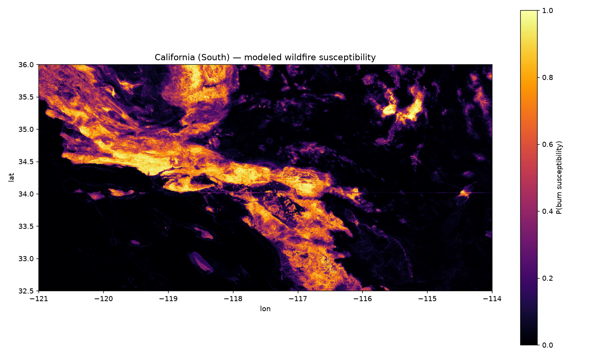

# Wildfire Susceptibility Mapping — Southern California, USA

Machine-learning wildfire susceptibility screening for Southern California
using only open data: CAL FIRE historical fire perimeters, SRTM elevation,
ESA WorldCover land cover, and PRISM climate normals.



> **Honesty note.** Positive labels are grid cells inside CAL FIRE FRAP
> fire perimeters (2015–2024) — documented large-fire footprints, not a
> complete record of every ignition (small fires are underrepresented).
> Treat this as a susceptibility **screening** — useful for prioritizing
> where to look closer — not an operational fire-behavior forecast.

## Problem

Southern California burns every year — from the 2018 Woolsey and Camp-era
complexes to the January 2025 Palisades/Eaton fires. This project asks:
can terrain, vegetation (fuel), and climate alone, learned from a decade
of documented perimeters, reproduce *where* the landscape burns?

## Data sources

| Data | Source | Accessed | Script |
|---|---|---|---|
| Fire perimeters 2015–2024 (1,888) | CAL FIRE FRAP "California Historical Fire Perimeters" (egis.CALFIRE), ArcGIS FeatureServer layer 2 | 2026-10-07 | `src/fetch_perimeters.py` |
| Elevation (SRTM, ~115 m) | Mapzen Terrarium tiles via `s3.amazonaws.com/elevation-tiles-prod` | 2026-10-07 | `src/fetch_dem.py` |
| Land cover (10 m) | ESA WorldCover 2021 v200, AWS Open Data (`s3://esa-worldcover`) | 2026-10-07 | `src/fetch_landcover.py` |
| Climate normals 1991–2020 (800 m) | PRISM Climate Group, Oregon State Univ. — July/August tmax + annual ppt | 2026-10-07 | `src/fetch_prism.py` |

> **Data-source notes (2026-10-07):**
> - `frap.fire.ca.gov` blocks non-browser clients (Akamai), so perimeters
>   were pulled from CAL FIRE's own official ArcGIS FeatureServer instead —
>   the same FRAP dataset.
> - The PRISM download portal moved to `data.prism.oregonstate.edu` and now
>   ships GeoTIFFs (not BILs); the fetch script handles the new layout.
> - GDAL `/vsicurl/` cannot verify this sandbox's egress TLS certificate,
>   so WorldCover tiles are downloaded with `requests` first, then read
>   locally (documented in `src/fetch_landcover.py`).

## Method

- **Grid:** 0.002° (~200 m), lon −121…−114, lat 32.5…36 (3,500 × 1,750).
- **Labels:** cells inside 2015–2024 perimeters = burned (3.69% of grid).
  30k positives; 30k negatives = 50% "hard" negatives from the 1–5 km ring
  outside perimeters + 50% background (>5 km). Water excluded.
  See `data/label_provenance.csv`.
- **Features (14):** elevation, slope, aspect southness, TPI (1 km),
  summer max temp, annual precipitation, distance to built-up (WUI proxy),
  one-hot fuel groups (forest/shrub/grass/crop/built/bare/non-burnable).
- **Model:** RandomForest (400 trees, balanced subsample) vs.
  logistic-regression baseline; stratified 5-fold CV on 75% train,
  final evaluation on held-out 25%. Seed 42.

## Results

All numbers below are measured from real runs (seed 42) — see
`outputs/metrics.json`. 60,000 labeled cells (30k burned / 30k unburned);
75% train with stratified 5-fold CV, 25% held-out test (n=15,000).

| Model | CV AUC | CV F1 | Held-out AUC | Held-out precision | Held-out recall | Held-out F1 |
|---|---|---|---|---|---|---|
| Random Forest (400 trees) | 0.942 ± 0.002 | 0.874 | **0.945** | 0.829 | 0.925 | 0.874 |
| Logistic regression (baseline) | 0.831 | 0.750 | 0.825 | 0.760 | 0.722 | 0.740 |

Held-out confusion (RF): TP 6,881 / FN 559 / FP 1,416 / TN 6,144.

Top features (Gini importance): annual precipitation 0.24, summer max
temp 0.18, slope 0.17, elevation 0.16, TPI 0.09 — climate and terrain
dominate; fuel-class one-hots contribute little once those are known.

Sanity check (burned vs. unburned means): elevation 974 vs 596 m, slope
11.0° vs 5.2°, TPI +0.8 vs −0.9 (ridges vs. valleys), summer tmax 31 vs
34 °C, annual ppt 502 vs 292 mm — physically sensible for Southern
California fire regimes (montane chaparral vs. desert).

## Limitations

1. FRAP perimeters emphasize larger, documented fires; small fires are
   underrepresented, so the model learns "large-fire likeness".
2. The high separability partly reflects geography (desert vs. chaparral)
   — disclosed, not hidden; the 1–5 km "hard" negatives keep it honest.
3. 200 m cells cannot resolve street-level fuel breaks or suppression
   effects; this is a screening map, not a tactical product.
4. Climate normals are 1991–2020 averages — they capture *where it is
   hot/dry*, not year-to-year drought anomalies.

## Reproduce

```bash
pip install -r requirements.txt
python src/fetch_perimeters.py
python src/fetch_dem.py
python src/fetch_prism.py
python src/fetch_landcover.py
python src/make_labels.py
python src/features.py
python src/train.py
```

## License

MIT — see [LICENSE](LICENSE).
